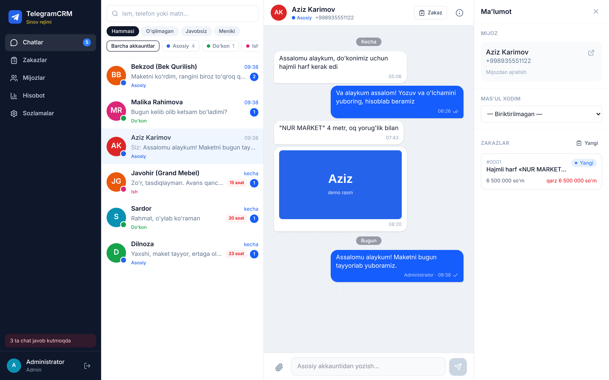
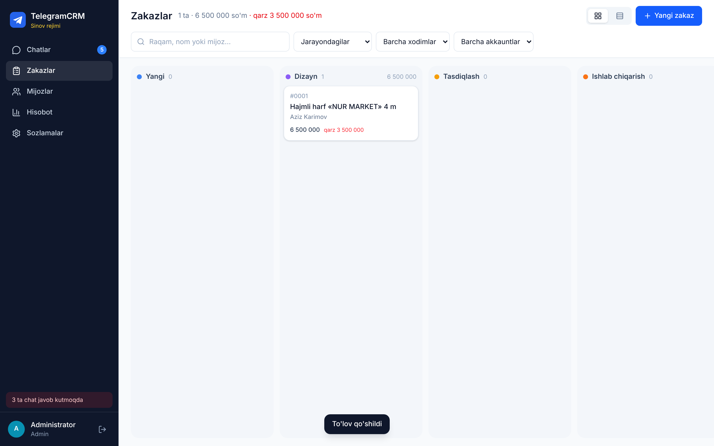
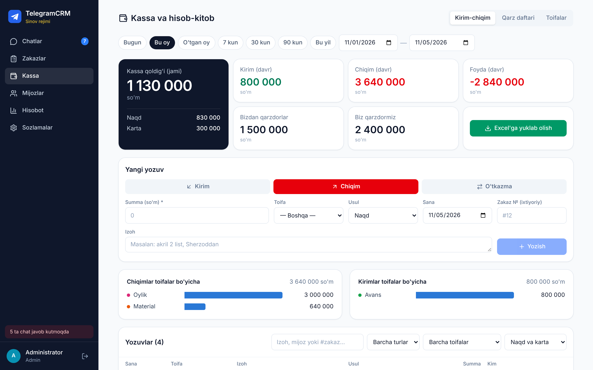
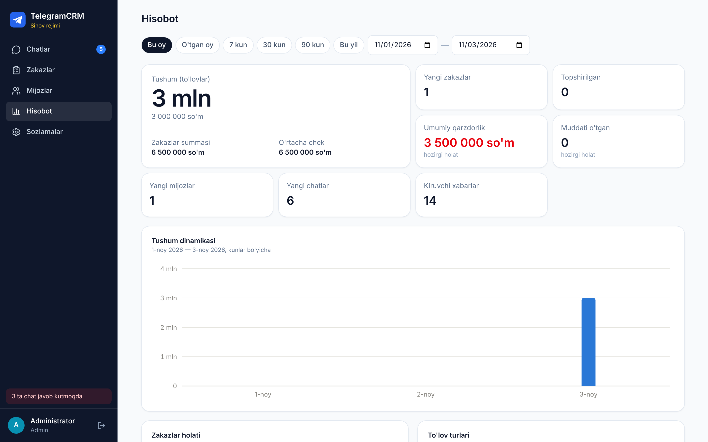

# TelegramCRM

Bir nechta Telegram akkauntni **bitta saytda** birlashtiradigan va ishlarni tizimlashtiradigan dastur.

- **Yagona chat oynasi** — 5–6 akkauntning shaxsiy chatlari, **guruhlari, kanallari va botlari** bitta ro'yxatda. Har bir chatda u qaysi akkauntga tegishli ekani rangli belgi bilan ko'rsatiladi. Javobni shu yerdan matn, rasm yoki fayl qilib yozasiz, botlarning tugmalarini bosasiz. Filtrlar: tur (Shaxsiy / Guruhlar / Kanallar / Botlar), papka, akkaunt, o'qilmagan, javobsiz, menga biriktirilgan, qidiruv.
- **Chatlarni o'zingiz tanlaysiz** — har bir akkauntdagi barcha chat, guruh, kanal va botlar ro'yxatidan keraklilarini belgilaysiz, qolgani yashirin turadi. O'z **papkalaringiz** («Mijozlar», «Ta'minotchilar»...) bor, keraksiz shovqinli guruhlarni **ovozsiz** qilish mumkin.
- **Zakazlar doskasi** — xabardan bir tugma bilan zakaz ochiladi, xabardagi rasm va fayllar zakazga o'tadi. Zakazlar holat ustunlarida turadi (Yangi → Dizayn → … → Topshirildi) va sichqoncha bilan suriladi. Har bir zakazda narx, to'lovlar, qarz, muddat, mas'ul xodim, fayllar, izohlar va o'zgarishlar tarixi saqlanadi. Maketni zakaz ichidan mijozga Telegram orqali yuborish mumkin.
- **Kassa (hisob-kitob)** — kirim va chiqimni qo'lda yozasiz (toifalar: material, ijara, oylik...), naqd va karta qoldig'i, davr bo'yicha foyda doim ko'rinib turadi. Zakaz to'lovlari kassaga avtomatik tushadi. **Qarz daftari**: kim sizdan qarz, siz kimga qarzsiz, qancha qaytarildi. Hammasini **Excel**ga yuklab olish mumkin.
- **Mijozlar bazasi** — mijoz qaysi akkauntlarga yozgan bo'lsa ham, uning hamma chatlari, zakazlari, jami summasi va qarzi bitta kartada. Bir odam uchun ikki karta ochilib qolsa, ularni birlashtirish mumkin.
- **Hisobot** — tanlangan davr bo'yicha kirim, chiqim, foyda, zakazlar, o'rtacha chek, qarzdorlik. Kirim-chiqim grafigi, to'lov turlari, eng yaxshi mijozlar, akkauntlar va xodimlar kesimi.
- **Telegram bot** — eslatmalar (javobsiz chatlar, muddatlar, yangi zakaz, har kungi hisobot), botga `+500000 avans` / `-80000 material` yozib **kassaga kiritish**, `/balans` kabi buyruqlar. Saytni **bot ichida ochish** ham mumkin (Mini App).
- **Xodimlar va ruxsatlar** — har bir xodimning o'z logini bor. Har kim faqat o'ziga ruxsat berilgan akkauntlarni ko'radi.
- Kompyuterda ham, telefonda ham ishlaydi. Yangi xabarlar sahifani yangilamasdan, darhol ko'rinadi.









| Rol | Nima qila oladi |
|---|---|
| Admin | Hammasi: akkauntlarni ulash, xodimlar, holatlar, kassa, hisobot, sozlamalar |
| Menejer | Ruxsat berilgan akkauntlar chatlari, chatlarni tanlash va papkalar, zakazlar, mijozlar, kassa (o'zi yozgan yozuvni o'zgartiradi) |
| Xodim | Faqat o'ziga biriktirilgan zakazlar: holatni o'zgartirish, izoh, fayl. Ruxsat berilsa, akkaunt chatlari ham |

## Qanday ishlaydi

Oddiy Telegram akkauntlarni bot orqali o'qib bo'lmaydi. Shuning uchun sayt Telegram'ning rasmiy
client API'sidan (MTProto, [Telethon](https://docs.telethon.dev) kutubxonasi) foydalanadi. Bu Telegram
Desktop kabi yana bitta "qurilma" sifatida ulanish degani. Har bir akkaunt saytga bir marta
telefon raqam, kod va kerak bo'lsa ikki bosqichli parol bilan ulanadi.

- Sessiyalar serverda **shifrlangan** holda saqlanadi (kalit — `.env` dagi `SECRET_KEY`).
- Telegram'ning kirish kodlari keladigan xizmat chati (777000) va «Saqlangan xabarlar» saytda **ko'rsatilmaydi**, shuning uchun xodimlar kodlarni ko'ra olmaydi.
- Akkaunt ulanganda Telegram «yangi qurilmadan kirildi» deb xabar yuboradi. Bu odatiy hol. Ulanishni istalgan vaqt telefondan uzish mumkin: Sozlamalar → Qurilmalar → TelegramCRM.
- Saytda hammaga birdan xabar tarqatish (rassilka) funksiyasi **yo'q** va qo'shilmaydi, chunki bunday tarqatish uchun Telegram akkauntlarni bloklaydi.
- Shaxsiy chatlar, guruhlar, kanallar va botlar ro'yxati saytga olinadi, lekin **xabarlari faqat siz tanlagan (ko'rinadigan) chatlar uchun** yuklanadi. Yashirin chatlarning xabarlari serverga saqlanmaydi.
- Siz admin bo'lmagan kanallarga yozib bo'lmaydi — ular faqat o'qish uchun ko'rinadi.

## Tayyorgarlik (bir marta)

1. **Telegram API kaliti.** [my.telegram.org](https://my.telegram.org) saytiga istalgan akkauntingiz bilan kiring → «API development tools» → ilova yarating (nomi ixtiyoriy). `api_id` va `api_hash` ni yozib oling. Bitta kalit barcha akkauntlar uchun yetadi.
2. **Eslatma boti (ixtiyoriy).** Telegram'da [@BotFather](https://t.me/BotFather) → `/newbot` → bot tokenini oling.
3. **Server (VPS).** Ubuntu 22.04 yoki 24.04, kamida 1 GB RAM (taxminan oyiga 5$, masalan Hetzner, DigitalOcean yoki mahalliy hosting).
4. **Domen (tavsiya etiladi).** Masalan `crm.sizning-domeningiz.uz`. Domenning A-yozuvini server IP manziliga yo'naltiring. Domen bo'lsa sayt avtomatik HTTPS bilan ishlaydi.

## Serverga o'rnatish

### Eng oson yo'l: bitta skript

Serverga `ssh root@SERVER_IP` bilan kiring va skriptni yuklab oling:

```bash
curl -fsSL https://raw.githubusercontent.com/sunnatillaavazovofficial-jpg/bot-plagin/refs/heads/claude/blissful-brown-asw2bf/TelegramCRM/install.sh -o install.sh
```

Keyin o'z qiymatlaringiz bilan ishga tushiring (Docker, git, `.env` va ishga tushirishni o'zi bajaradi;
qayta ishga tushirish xavfsiz — maxfiy kalit va parol saqlanadi):

```bash
DOMAIN=sizning.domeningiz BOT_TOKEN=bot_tokeni ADMIN_TG_ID=telegram_id_raqamingiz bash install.sh
```

Oxirida sayt manzili, login va (birinchi marta) admin paroli ekranga chiqadi. Keyinroq `TG_API_ID=… TG_API_HASH=…`
bilan qayta ishga tushirsangiz, Telegram akkauntlarni ulash yoqiladi.

**`.env` ni kompyuterda to'ldirgan bo'lsangiz** (Windows): avval faylni serverga yuboring (PowerShell'da), keyin
skriptni shu fayl bilan ishga tushiring. Windows qator oxirlari avtomatik tuzatiladi, admin paroli fayldagi
`ADMIN_PASSWORD` ga o'rnatiladi, bo'sh `SECRET_KEY` o'zi to'ldiriladi:

```bash
scp "C:\Users\Siz\Desktop\TelegramCRM\.env" root@SERVER_IP:/root/crm.env
```

```bash
ENV_FILE=/root/crm.env bash install.sh
```

### Serverda boshqa sayt bo'lsa

Serverda boshqa sayt ishlayotgan bo'lsa, 80 va 443-portlarni u band qilgan bo'ladi. Odatda bu nginx yoki apache. Skript buni o'zi aniqlaydi va mavjud saytni o'chirmaydi:

- CRM serverning ichki portida ishlaydi (`127.0.0.1:8181`, `.env` dagi `APP_PORT`). Tashqaridan bu port ko'rinmaydi.
- Mavjud nginx yoki apache'ga faqat `DOMAIN` uchun alohida blok qo'shiladi:
  - nginx'da: `/etc/nginx/sites-available/telegramcrm.conf`;
  - apache'da: `/etc/apache2/sites-available/telegramcrm.conf`.
- Boshqa saytlarning sozlamalariga tegilmaydi. Yangi blok tekshiruvdan (`nginx -t` / `apachectl configtest`) o'tmasa, u olib tashlanadi.
- Bepul HTTPS sertifikati `certbot` bilan olinadi. Domen hali serverga yo'naltirilmagan bo'lsa, sayt vaqtincha `http://` orqali ochiladi; domenni tuzatib, skriptni qayta ishga tushiring.
- Port hosting paneli (aaPanel, ISPmanager va h.k.) yoki boshqa dastur qo'lida bo'lsa, skript hech narsani o'zgartirmaydi va «DIQQAT» xabarini chiqaradi.

Portni qaysi dastur egallaganini qo'lda ko'rish:

```bash
ss -ltnp | grep -E ':80 |:443 '
```

**Admin parolini unutdingizmi?** Serverda:

```bash
cd ~/bot-plagin/TelegramCRM && docker compose exec app python -m app.cli reset-password admin YangiParol123
```

### Qo'lda o'rnatish


Serverga SSH orqali kiring va Docker'ni o'rnating:

```bash
curl -fsSL https://get.docker.com | sh
```

Kodni yuklab oling:

```bash
git clone https://github.com/sunnatillaavazovofficial-jpg/bot-plagin.git
```

```bash
cd bot-plagin/TelegramCRM
```

Sozlamalar faylini yarating:

```bash
cp .env.example .env
```

Maxfiy kalit yarating va chiqqan satrni `.env` dagi `SECRET_KEY=` ga qo'ying:

```bash
openssl rand -hex 32
```

`.env` faylini to'ldiring: `ADMIN_PASSWORD`, `TG_API_ID`, `TG_API_HASH`, `BOT_TOKEN`, `ADMIN_TG_ID`
(sizning Telegram ID'ingiz — admin botga oldindan bog'lanadi), `DOMAIN` va
saytni bot ichida ochish uchun `PUBLIC_URL` (masalan `https://crm.sizning-domeningiz.uz`).

```bash
nano .env
```

Ishga tushiring:

```bash
docker compose up -d --build
```

Bir-ikki daqiqadan keyin brauzerda `https://sizning-domeningiz` manzilini oching. Domen bo'lmasa `http://SERVER_IP` manzilini oching, bu holda `.env` da `COOKIE_SECURE=0` bo'lsin. `admin` login va `.env` dagi parol bilan kiring.

### Birinchi sozlash

1. **Sozlamalar → Telegram akkauntlar → Akkaunt qo'shish.** Telefon raqamni kiriting, keyin shu akkauntning Telegram ilovasiga kelgan kodni yozing. Har bir akkauntga nom va rang bering. Shu yerda «yangi chatlar avtomatik ko'rinsin» belgilari bor: odatda faqat shaxsiy chatlar avtomatik ko'rinadi, guruh, kanal va botlarni o'zingiz tanlaysiz.
2. **Sozlamalar → Chatlarni tanlash.** Kerakli guruh, kanal va botlarni «Ko'rinadi» qiling, papkalar oching va chatlarni ularga joylang. Ko'pini birdan belgilab, bir tugma bilan ko'rsatish yoki yashirish mumkin.
3. **Sozlamalar → Xodimlar.** Har bir xodimga login yarating va qaysi akkauntlarni ko'rishini belgilang.
4. **Sozlamalar → Zakaz holatlari.** Ustunlarni o'z ish jarayoningizga moslang.
5. **Sozlamalar → Profil → Botni ulash.** Har bir xodim o'zi bosadi, shunda eslatmalar unga keladi va (admin/menejer bo'lsa) botdan kassaga yoza oladi.
6. **Sozlamalar → Eslatmalar.** Kunlik hisobot vaqti va javobsiz chat uchun daqiqa chegarasini sozlang.
7. **Kassa → Kirim-chiqim.** Birinchi yozuv sifatida hozirgi naqd va kartadagi pulni «Boshlang'ich qoldiq» toifasi bilan kirim qiling.

## Kassa va qarz daftari

- **Kirim / Chiqim / O'tkazma.** O'tkazma — naqd puldan kartaga (yoki aksincha) o'tkazish; u foydaga ta'sir qilmaydi, faqat qoldiqlarni o'zgartiradi.
- Zakazga kiritilgan to'lov kassada «Zakaz to'lovi» bo'lib ko'rinadi. Kassada yozuv qo'shganda «Zakaz №» ni yozsangiz, u shu zakazning to'lovi hisoblanadi.
- «Boshlang'ich qoldiq» foyda hisobiga kirmaydi, faqat kassa qoldig'iga qo'shiladi.
- **Qarz daftari:** «Menga qarz» — kimdir sizga qaytarishi kerak; «Men qarzman» — siz to'lashingiz kerak. Pul hozir berilgan/olingan bo'lsa, belgilab qo'ysangiz kassaga ham yoziladi. «Qaytardi» / «To'ladik» tugmasi qoldiqni kamaytiradi, to'liq to'langanda qarz yopiladi. To'liq to'lanmagan zakazlar ham shu yerda avtomatik ko'rinadi.
- **Excel:** Kassa sahifasidagi tugma tanlangan davr bo'yicha «Kirim-chiqim», «Toifalar bo'yicha» va «Qarz daftari» varaqlari bilan fayl beradi.
- Kassani admin va menejerlar ko'radi. Menejer faqat o'zi kiritgan yozuvni o'zgartira yoki o'chira oladi.

## Bot orqali kirim-chiqim

Botga bog'langan admin va menejerlar botga shunday yozadi:

| Yozasiz | Natija |
|---|---|
| `+500000 Aziz avans` | Kirim 500 000, toifa «Avans», naqd |
| `-80 ming bo'yoq` | Chiqim 80 000, toifa «Material» |
| `-1 200 000 ijara karta` | Chiqim 1 200 000, toifa «Ijara», karta |
| `+1.5mln click #12` | 12-zakazga 1 500 000 to'lov, karta |

Summa `500000`, `500 000`, `80k`, `80 ming`, `1.5mln` ko'rinishida bo'lishi mumkin. Matnda «karta, plastik,
click, payme» bo'lsa karta, aks holda naqd hisoblanadi. Javob xabaridagi tugmalar bilan toifani tanlash,
naqd/kartani almashtirish yoki yozuvni bekor qilish mumkin.

Buyruqlar: `/balans` — kassa qoldig'i, `/bugun` — bugungi kirim-chiqim, `/oy` — shu oy natijasi,
`/qarzlar` — ochiq qarzlar, `/yordam` — qo'llanma.

## Saytni Telegram ichida ochish (Mini App)

`.env` da `PUBLIC_URL=https://sizning-domeningiz` yozilgan bo'lsa (HTTPS shart), botning pastki chap
burchagida «CRM» tugmasi paydo bo'ladi. U butun saytni Telegram ichida ochadi. Botni ulagan xodim login va
parolsiz avtomatik kiradi. Telefon va kompyuterdagi Telegram ilovasida ishlaydi; brauzerdagi Telegram Web'da
kirish saqlanmasligi mumkin, u holda saytni oddiy brauzerda oching.

## Domen va Google / Yandex

Bosh sahifa (`/` — o'zbekcha, `/ru` — ruscha) **ochiq**: unda kompaniya haqida matn, xizmatlar, kontaktlar va
xodimlar uchun kirish formasi turadi. Google va Yandex faqat shu sahifani ko'radi. Chatlar, zakazlar, kassa
va boshqa bo'limlar faqat parol bilan ochiladi va qidiruvga chiqmaydi (`robots.txt`, `noindex`).
Kompaniya nomi kiritilmaguncha sayt qidiruv tizimlaridan butunlay yopiq turadi.

1. **DNS** (domen sotib olingan joyda): `A @ → server IP` va `A www → server IP`.
2. **`.env`:** `DOMAIN=media-max.net`, `WWW_DOMAIN=www.media-max.net`, `PUBLIC_URL=https://media-max.net`,
   `COOKIE_SECURE=1`. Tayyor matn kerak bo'lsa: `SITE_PRESET=media-max` (faqat bo'sh maydonlarni to'ldiradi).
   Keyin `docker compose up -d --build`.
3. **Matnni tahrirlash:** Sozlamalar → «Ochiq sahifa (Google)».
4. **Google Search Console:** «URL prefiksi» → `https://media-max.net` → «HTML teg». Tegni Sozlamalar'dagi
   «Google tasdiqlash kodi» maydoniga yopishtiring, saqlang, «Tasdiqlash»ni bosing. «Sitemaps» → `sitemap.xml`.
5. **Yandex Webmaster:** saytni qo'shing → «Meta-teg». Tegni «Yandex tasdiqlash kodi» maydoniga yopishtiring,
   saqlang, «Проверить»ni bosing. «Индексирование → Файлы Sitemap» → `https://media-max.net/sitemap.xml`.

Qidiruvda paydo bo'lishi bir necha kundan bir necha haftagacha oladi. Mahalliy qidiruv va xaritada chiqish uchun
Google Business Profile va Yandex Бизнес'da ham kompaniyani ro'yxatdan o'tkazing.

## Kundalik ishlar

Yangilash (yangi versiya chiqqanda):

```bash
git pull && docker compose up -d --build
```

Yoki `bash install.sh` ni qayta ishga tushiring: u Caddy yoki mavjud nginx/apache tanlovini ham o'zi qiladi.
Qo'lda yangilaganda, serverda boshqa sayt bo'lmasa, `.env` da `COMPOSE_PROFILES=caddy` qatori bo'lishi kerak.
Bu qator bo'lmasa, Caddy (HTTPS) ishga tushmaydi.

Loglarni ko'rish:

```bash
docker compose logs -f app
```

Zaxira nusxalar: baza har kuni soat 03:00 da avtomatik nusxalanadi (oxirgi 14 kun saqlanadi).
Ularni konteynerdan server papkasiga ko'chirish (keyin `scp` bilan kompyuterga yuklab olasiz):

```bash
docker compose cp app:/data/backups ./backups
```

Barcha ma'lumotlar (baza, fayllar, sessiyalar) `crm-data` nomli Docker hajmida saqlanadi.
`docker compose down` ularni o'chirmaydi. `docker compose down -v` esa **hammasini o'chiradi**, ehtiyot bo'ling.

> `SECRET_KEY` ni o'zgartirmang. O'zgarsa, saqlangan sessiyalarni o'qib bo'lmaydi va barcha akkauntlarni qayta ulash kerak bo'ladi.

## Sinov rejimi (Telegram'siz)

`.env` da `TG_FAKE=1` qilsangiz, sayt Telegram'ga ulanmaydi va demo akkauntlar, chatlar bilan ishlaydi.
Har 45 soniyada «mijoz»dan yangi xabar keladi. Yangi akkaunt qo'shishda kod `12345` bo'ladi.
Demo guruh, kanal, tugmali bot va namunaviy kassa yozuvlari ham bor (kassa namunasisiz: `DEMO_FINANCE=0`).
Bu rejim saytni ko'rib chiqish va xodimlarni o'rgatish uchun.

## Dasturchilar uchun

```
TelegramCRM/
  backend/      FastAPI + Telethon + SQLAlchemy (SQLite), Alembic migratsiyalari, testlar
    app/telegram/manager.py   haqiqiy akkauntlar (MTProto): kirish, sinxron, hodisalar, yuborish, media
    app/telegram/fake.py      sinov rejimi
    app/telegram/store.py     xabar va chatlarni bazaga yozish (ikkala rejim uchun umumiy)
    app/routers/              REST API va /ws (WebSocket)
    app/finance.py            kassa mantig'i (qoldiq, zakaz to'lovlari, qarzlar)
    app/notify/               bot: eslatmalar, kassaga yozish (finance_bot.py), fon vazifalari, zaxira nusxa
  frontend/     React + Vite + TypeScript + Tailwind
  Dockerfile, docker-compose.yml, Caddyfile
```

Backend'ni sinov rejimida ishga tushirish:

```bash
cd backend && pip install -r requirements-dev.txt
```

```bash
TG_FAKE=1 DATA_DIR=./data uvicorn app.main:app --reload --port 8000
```

Frontend (alohida terminalda; `/api` va `/ws` so'rovlari 8000-portga yo'naltiriladi):

```bash
cd frontend && npm install && npm run dev
```

Testlar:

```bash
cd backend && python -m pytest -q
```

Baza tuzilmasini o'zgartirgandan keyin yangi migratsiya yarating
(ilova har ishga tushganda migratsiyalarni o'zi qo'llaydi):

```bash
cd backend && TG_FAKE=1 DATA_DIR=./data python -c "from alembic import command; from app.migrate import upgrade_database, alembic_config as c; upgrade_database(); command.revision(c(), message='ozgarish', autogenerate=True)"
```

Muhim: ilova **bitta jarayonda** ishlashi kerak (`uvicorn` ga `--workers` bermang), chunki
Telegram ulanishlari va real vaqt xabarlari shu jarayon xotirasida turadi.
